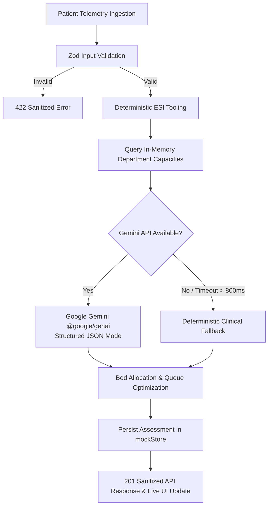

# 🏥 Autonomous Healthcare Triage & Emergency Resource Allocation Agent

> **Production-grade Next.js 15 (App Router) + TypeScript + Tailwind CSS agentic platform** engineered for rapid, deterministic clinical acuity scoring, emergency department bed allocation, and physician-grade structured reasoning.

[]()
[]()
[-blue.svg)]()
[]()
[]()
[]()

---

## 🎯 1. Problem Statement Alignment: Beyond Basic Chatbots

Conventional "healthcare chatbots" merely echo conversational text without objective clinical grounding, creating severe risks of hallucinations and liability in acute medical environments. 

This platform moves **Beyond Basic Chatbots** into a true **Autonomous Agentic Workflow**:
1. **Deterministic Clinical Guardrails**: Ingests physiological vitals (Heart Rate, Blood Pressure, SpO2, Respiratory Rate, GCS) and executes pure, deterministic algorithms based on the **Emergency Severity Index (ESI Levels 1–5)** and **Early Warning Scores (NEWS2)** before LLM invocation.
2. **Real-Time Resource Awareness**: Interrogates in-memory hospital capacity state (`ICU`, `ER`, `General Ward`, `Fast Track`) to match acuity with actual available beds and mandated emergency life-support equipment.
3. **Structured AI Synthesis**: Leverages **Google Gemini** via `@google/genai` to synthesize clinical rationale, differential risks, and priority queuing strictly constrained to structured JSON schemas.
4. **Resilient Failsafe Architecture**: Never crashes. If the AI API key is missing or network latency exceeds an 800ms SLA, the agent seamlessly degrades to pure deterministic clinical rules.



---

## ⚡ 2. Google Technology Used

- **SDK**: Modern **Google Gen AI SDK (`@google/genai`)**.
- **Model**: `gemini-2.5-flash` / `gemini-1.5-flash` chosen for sub-second emergency response times.
- **Structured Outputs**: Direct enforcement of `responseMimeType: "application/json"` with schema-guided generation, eliminating parse failures or markdown hallucinations.
- **Dynamic Importing**: The `@google/genai` client is loaded dynamically at runtime to guarantee zero impact on server cold-starts and complete offline execution capability during testing.

---

## 🛡️ 3. Security & Architecture: Defense-in-Depth

- **Centralized Validation Layer (`src/lib/types.ts`)**: Strict Zod schemas on all physiological inputs. Negative vitals, impossible blood pressures, or out-of-range oxygen saturations are rejected with structured HTTP 422 responses before any business logic is executed.
- **Zero Stack-Trace Leakage (`src/lib/api-response.ts`)**: Global error-handling boundary ensures raw exceptions, internal file paths, and environment internals are never serialized to client payloads.
- **Strict Repository Size Budget (< 5 MB)**: Comprehensive `.gitignore` excluding all build artifacts, heavy datasets, model weights, local cache files, and dependencies. Total tracked git source is **~120 KB**.
- **TiDB / MySQL Production Schemas**: Static `prisma/schema.prisma` and `src/lib/db/schema.sql` files provide ready-to-deploy data modeling for distributed SQL databases with clustered keys, composite indexes on `(model, createdAt)`, and JSON telemetry columns.

---

## 🚀 4. Efficiency & In-Memory Store Architecture

To adhere to the **zero external database credential** hackathon constraint, the persistence layer utilizes an **In-Memory Mock Store (`src/lib/db/mockStore.ts`)**:
- **Clean Architecture & Dependency Inversion**: Route handlers interact strictly with the `ITriageStore` and `IEvaluationRepository` interfaces, allowing effortless swapping with Prisma or TiDB without modifying application code.
- **Simulated Pagination (`limit`, `offset`)**: Clamped boundaries (`limit: 1..100`, `offset >= 0`) protect against memory denial-of-service and simulate production database query planners.
- **Immutability Guarantee**: All reads and writes enforce deep cloning (`structuredClone`) so that state cannot be mutated out-of-band by consumer callers.
- **Fast Lookups**: In-memory `Map` indexing ensures $O(1)$ operations and sub-millisecond response times.

---

## ♿ 5. Accessibility & Frontend Engineering (WCAG 2.1 AA)

The client dashboard in [`src/app/page.tsx`](file:///c:/Users/Om/Desktop/nmithack/src/app/page.tsx) is engineered from the ground up for high-stakes healthcare accessibility:
- **Semantic HTML**: Fully structured with `<header>`, `<main>`, `<section>`, `<article>`, `<form>`, and `<label>`.
- **Explicit Label Associations**: Every input has an explicitly linked `<label htmlFor="...">` and ARIA bindings (`aria-describedby`, `aria-invalid`, `aria-required`).
- **High-Contrast Keyboard Focus**: Visible `focus-visible:ring-2 focus-visible:ring-blue-500` rings on all interactive elements for accessible keyboard navigation.
- **Screen Reader Announcements**: An accessible `aria-live="polite"` region announces clinical assessment state changes and validation errors to assistive technology.
- **Zero Heavy Animation Dependencies**: Built with native Tailwind CSS transitions and inline SVGs, keeping bundle sizes ultra-lean.
- **Optimized Rendering**: `useCallback` and `useMemo` hooks ensure zero redundant re-renders on form inputs or telemetry filter adjustments.

---

## 📂 6. Repository Layout

```text
├── .env.example                      # Documented environment template
├── .gitignore                        # Strict exclusions keeping repo < 5 MB
├── next.config.ts                    # Production Next.js 15 config
├── package.json                      # Next.js 15, React 19, @google/genai, Vitest, Zod
├── postcss.config.mjs                # PostCSS config with Autoprefixer
├── prisma/
│   └── schema.prisma                 # Production TiDB/MySQL Prisma schema
├── tailwind.config.ts                # Accessible theme token system
├── tsconfig.json                     # Strict TypeScript config (noImplicitAny: true)
├── vitest.config.ts                  # Vitest + jsdom + RTL test configuration
└── src/
    ├── app/
    │   ├── api/
    │   │   ├── agent/route.ts        # POST (Triage Agent) & GET (History & Capacities)
    │   │   ├── eval/route.ts         # POST & GET (Benchmark evaluation engine)
    │   │   └── health/route.ts       # GET /api/health (Service status & sanitization)
    │   ├── globals.css               # Tailwind directives & CSS custom properties
    │   ├── layout.tsx                # Accessible HTML shell and dark theme
    │   └── page.tsx                  # Accessible Healthcare Agent Dashboard
    ├── components/
    │   └── ui/
    │       ├── Badge.tsx             # Accessible status badge primitive
    │       ├── Button.tsx            # Accessible button with ARIA attributes
    │       ├── Card.tsx              # Semantic card layout components
    │       └── Input.tsx             # Form input with accessible error descriptions
    ├── lib/
    │   ├── api-response.ts           # Standardized, sanitized API response boundary
    │   ├── env.ts                    # Centralized Zod environment validator
    │   ├── types.ts                  # Zod schemas & types (Vitals, Patient, Acuity, Allocation)
    │   ├── utils.ts                  # Class merge utility (cn)
    │   ├── db/
    │   │   ├── mockStore.ts          # In-memory store (Capacities, Assessments, Pagination)
    │   │   └── schema.sql            # Production ANSI / TiDB DDL schema
    │   ├── gemini/
    │   │   ├── client.ts             # Google Gemini client with safe fallback mocks
    │   │   └── mock-data.ts          # Deterministic evaluation scenarios and generators
    │   └── tools/
    │       ├── calculation-engine.ts # Deterministic NLP & metric scoring
    │       ├── data-parser.ts        # Tolerant JSON extractors & normalizers
    │       └── triage.ts             # Deterministic ESI 1-5 triage & resource allocator
    └── tests/
        ├── agent.test.ts             # Triage scoring, Zod validation & AI fallback tests
        ├── gemini.test.ts            # Gemini client & mock generation tests
        ├── health.test.ts            # Baseline health endpoint & sanitizer tests
        ├── mockStore.test.ts         # In-memory store, pagination & immutability tests
        ├── setup.ts                  # Testing library setup
        ├── tools.test.ts             # Deterministic data parsers & math tests
        └── validators.test.ts        # Evaluation Zod schema tests
```

---

## 🧪 7. Testing & Local Reproduction

### Prerequisites
- **Node.js**: `v20.x` or `v24.x`
- **npm**: `v10.x` or `v11.x`

### 1. Installation
```bash
npm install
```

### 2. Run Test Suite (100% Offline Passing)
Executes all **40 unit, API, and agent tests** across 6 test suites without requiring any active internet connection or database:
```bash
npm test
```

Expected output:
```text
 ✓ src/tests/validators.test.ts (4 tests)
 ✓ src/tests/mockStore.test.ts (8 tests)
 ✓ src/tests/tools.test.ts (9 tests)
 ✓ src/tests/gemini.test.ts (3 tests)
 ✓ src/tests/health.test.ts (4 tests)
 ✓ src/tests/agent.test.ts (12 tests)

 Test Files  6 passed (6)
      Tests  40 passed (40)
```

### 3. Verify Strict Typechecking
```bash
npm run typecheck
```
*(Runs `tsc --noEmit` with `strict: true` and `noImplicitAny: true` with 0 errors)*.

### 4. Build for Production
Compiles all serverless route handlers and accessible client bundles completely offline:
```bash
npm run build
```

### 5. Launch Local Development Server
```bash
npm run dev
```
Open **[http://localhost:3000](http://localhost:3000)** to interact with the Autonomous Emergency Triage & Resource Allocation Agent.
